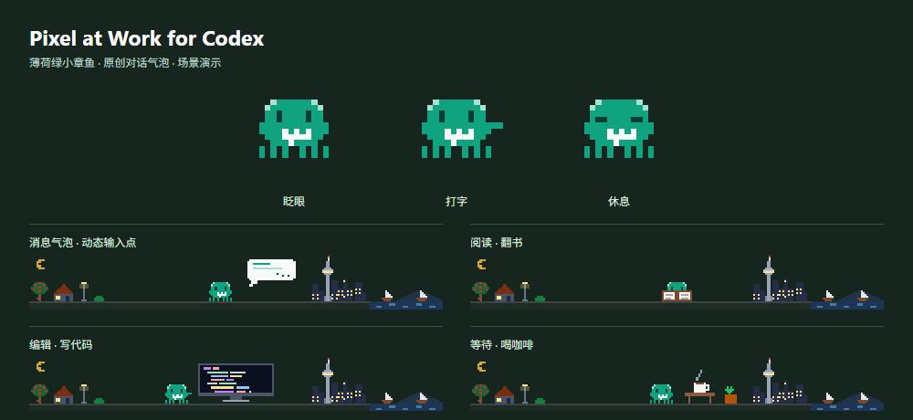

<p align="center"><sub>A LITTLE COMPANY WHILE YOU BUILD</sub></p>

<h1 align="center">Pixel at Work <sub>for Codex</sub></h1>

<p align="center"><strong>让 Codex 的工作状态，变成桌边小机器人的日常。</strong><br>
A tiny conversation robot beside your desktop composer.</p>

<p align="center">
  <a href="https://github.com/yzdashuaige111-eng/pixel-at-work-codex/releases/latest"><strong>下载 Windows x64 →</strong></a>
  &nbsp;·&nbsp; <a href="#下载与启动">快速开始</a>
  &nbsp;·&nbsp; <a href="#控制">快捷操作</a>
  &nbsp;·&nbsp; <a href="#会话如何连接">连接说明</a>
</p>

<p align="center"><sub>Windows 10/11 x64 &nbsp; / &nbsp; 透明悬浮 &nbsp; / &nbsp; 鼠标穿透 &nbsp; / &nbsp; MIT</sub></p>

<p align="center">
  
</p>

<p align="center"><sub>阅读、编辑、查资料、运行工具，让等待多一点趣味。</sub></p>

Windows 桌面悬浮伴侣，显示在 Codex / ChatGPT 桌面输入框附近。**活动状态来自本地 Codex 会话记录**；普通 ChatGPT 聊天不一定产生这些记录。本项目是独立社区项目，与 OpenAI 无隶属关系，也不是官方插件。

---

## 一个小伙伴，三件小事

| 看见进展 | 留出空间 | 数据留在本地 |
| --- | --- | --- |
| 根据阅读、编辑、测试、完成与失败等活动切换动画 | 跟随输入框、避让文字，透明区域与角色均可点击穿透 | 悬浮程序不上传会话内容，图案只接收活动类别与完成状态 |

中央角色与辅助机器人均重新设计，具有白色圆头、黑色面屏、绿色对话灯、双臂和双脚；眨眼、读屏、打字、行走和跳跃使用新的角色动作。场景道具与节日装饰延续原作，并保留 MIT 署名。

## 下载与启动

1. 到 [Releases](https://github.com/yzdashuaige111-eng/pixel-at-work-codex/releases/latest) 下载 Windows x64 压缩包。当前公开发行版为 [v0.2.1](https://github.com/yzdashuaige111-eng/pixel-at-work-codex/releases/tag/v0.2.1)，文件名为 `PixelAtWork-Codex-v0.2.1-windows-x64.zip`。
2. 解压到一个可以写入文件的文件夹，双击“启动悬浮条.vbs”或 PixelAtWork.exe。
3. 打开 Codex / ChatGPT 桌面应用。动画自动出现在输入框附近的空白位置。

发行页的 `CHECKSUMS.txt` 提供压缩包 SHA-256；可在 PowerShell 中运行 `Get-FileHash .\PixelAtWork-Codex-v0.2.1-windows-x64.zip -Algorithm SHA256` 后比对。

运行环境：Windows 10/11 x64、.NET Framework 4.8、Microsoft Edge WebView2 Runtime。只支持 Windows x64；macOS 与 Linux 尚未支持。压缩包包含 WebView2 SDK 的必要文件，浏览器运行时需已安装。

## 控制

| 操作 | 方法 |
| --- | --- |
| 显示 / 隐藏 | Ctrl+Alt+O，或双击托盘图标 |
| 微调位置 | Ctrl+Alt+方向键，每次 12 个逻辑像素 |
| 手动定位 | 鼠标放在输入框顶边中间，按 Ctrl+Alt+P |
| 恢复自动对齐 | 托盘 → 自动对齐输入框 |
| 暂停动画 | 托盘 → 减少动画 |
| 切换状态来源 | 托盘 → 绑定最近活动的 Codex 会话 |
| 退出 | 托盘 → 退出悬浮条 |

图案和透明区域都让鼠标点击穿透，不抢输入焦点。切换到其他应用或最小化主窗口时隐藏。

<details>
<summary><strong>定位与避让规则</strong></summary>

位置通过 Windows 可访问性边界跟随输入框，支持分栏和输入框高度变化。输入框上方没有文字或控件时显示完整场景；新聊天的欢迎文字、正文或菜单占据该位置时，收为输入框侧边的小机器人。没有输入框、没有足够空白空间或无法可靠识别界面时自动隐藏，不再使用旧坐标兜底。手动定位与微调也执行文字避让。

已选中的安全位置会保持稳定。进入侧边模式后，任务状态改变或菜单消失不会使它自动跳回上方；窗口和输入框真正移动时才跟随调整。需要重新选择位置时，在托盘选择“自动对齐输入框”。


</details>

## 会话如何连接

首次启动自动生成本地 config.json。Codex 数据位置取环境变量 CODEX_HOME，未设置时使用用户目录下的 .codex。会话取 CODEX_THREAD_ID，未设置时选择最近更新的本地会话记录。

**位置跟随桌面窗口，活动跟随绑定的 Codex 会话。** 切换聊天不会自动重新绑定。多任务同时运行时，“最近活动”可能是后台任务；如需精确绑定，可编辑 config.json 中的 threadId 后重启。

配置示例见 [config.example.json](config.example.json)。codexHome 和 threadId 留空会在启动时自动检测；也可以分别填入自己的 Codex 数据目录和会话 ID。

工具状态来自 Codex 的本地会话记录。普通 ChatGPT 聊天不一定产生这些记录。记录格式及桌面控件结构并非稳定的公开插件接口，应用更新后可能需要适配。“正在处理”只表示任务尚未结束；合并工具调用按可见名称归类，无法保证每个子调用都有独立动画。

原作保留 41 种场景；已连接阅读、查找、编辑、网络查资料、构建、测试、下载、装依赖、Git、Python、运行工具、等待回答、完成和失败等活动。

## 本地数据

悬浮程序不上传会话内容，不修改宿主安装文件或 Codex 配置，也不创建开机启动项。图案只收到活动类别及完成状态；提示词、文件路径、命令参数、工具输出不会发送到图案或写入诊断记录。

config.json、status.json、diagnostic.log 和 browser-data 都保存在程序目录。它们属于本地运行数据，不随仓库或发行包分发。动画与演示完全离线；从源码构建首次会下载固定版本的 WebView2 SDK，并检查 SHA-256。

## 常见问题

- **启动后没有角色**： 先确认主窗口已打开且可见，检查托盘显示/隐藏状态，再选择“自动对齐输入框”。没有输入框、空间不足或界面无法可靠识别时，程序会自动隐藏。
- **活动与当前聊天不匹配**： 活动来源是绑定的 Codex 会话。使用托盘“绑定最近活动的 Codex 会话”，或修改 `config.json` 的 `threadId` 后重启；多个任务并行时需核对会话。
- **角色一直安静**： 普通 ChatGPT 聊天不一定写入本地 Codex 会话记录；也可检查托盘的“减少动画”和 [配置示例](config.example.json)。
- **提示启动失败**： 检查 Edge WebView2 Runtime、完整解压的程序文件和同目录 `diagnostic.log`；程序目录需要可写。

问题可提交到 [Issues](https://github.com/yzdashuaige111-eng/pixel-at-work-codex/issues)，注明版本、Windows 缩放、复现步骤和会话绑定方式。分享日志前检查个人路径与会话标识。

## 从源码构建

需要 Node.js 24，以及 Windows 自带的 .NET Framework C# 编译器。

在 PowerShell 中运行：

```powershell
.\build.ps1 -Test
.\package.ps1 -Version 0.2.1
```

build-art.mjs 从保留的上游源码提取 SVG 场景，再应用独立的 mascot.ts。生成 artwork.js 后编译 WPF / WebView2 桌面程序。测试检查任务开始、工具调用与结果、失败状态、跨段 UTF-8 和任务结束，以及新聊天文字避让、左右侧边、无输入框、窄窗口、200% 缩放和位置微调。

package.ps1 按明确的文件清单生成压缩包，附依赖许可证与 CHECKSUMS.txt；不会打包本地会话配置、缓存或屏幕截图。

## 源码导航

| 入口 | 内容 |
| --- | --- |
| [PixelAtWork.cs](PixelAtWork.cs) · [Placement.cs](Placement.cs) | 桌面宿主、会话读取与位置避让 |
| [mascot.ts](mascot.ts) · [build-art.mjs](build-art.mjs) | 原创角色与动画生成 |
| [config.example.json](config.example.json) | 本地配置字段 |
| [source-provenance.json](source-provenance.json) · [第三方声明](THIRD_PARTY_NOTICES.md) | 上游来源与依赖许可 |

## 致谢与许可

场景道具、场景编排与奥克兰天际线源自 [zhuoxingzhang/pixel-at-work](https://github.com/zhuoxingzhang/pixel-at-work)，作者 Zhuoxing Zhang，MIT 许可证。原始源码未改动，位于 upstream，校验记录见 source-provenance.json。

本项目新增 Windows 悬浮宿主、Codex 会话适配、原创对话机器人、聊天气泡场景和文字避让，采用 MIT 许可证。WebView2 的许可单独保留，见 [THIRD_PARTY_NOTICES.md](THIRD_PARTY_NOTICES.md)。

这是独立社区项目，与 OpenAI 无隶属关系，也不是官方插件。ChatGPT、Codex 等名称用于说明兼容目标；机器人和对话图案为原创像素设计，未使用官方徽标。
